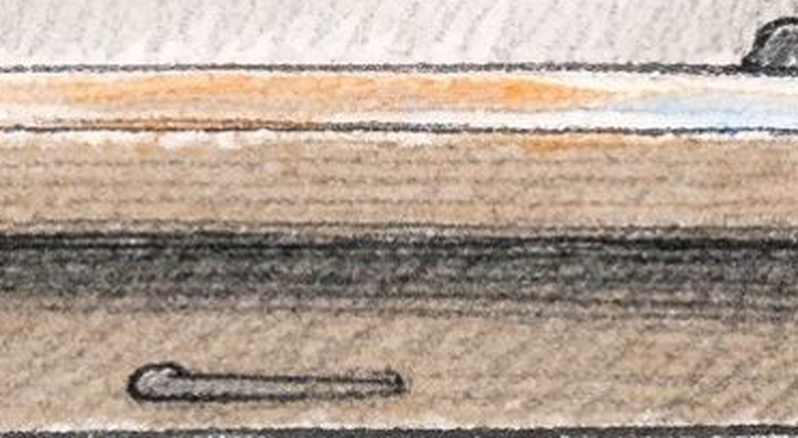
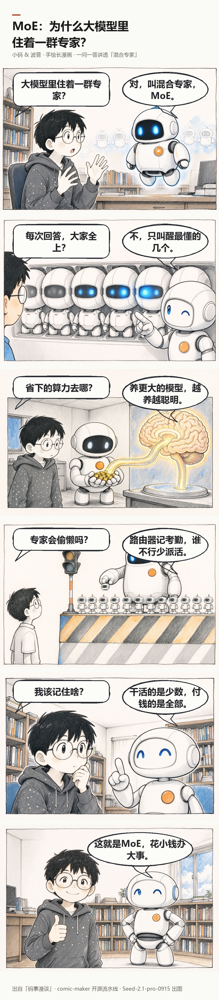
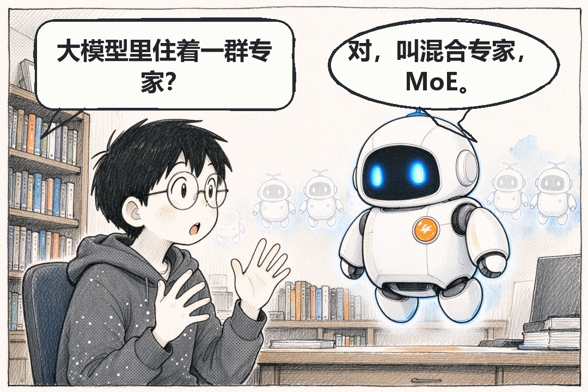
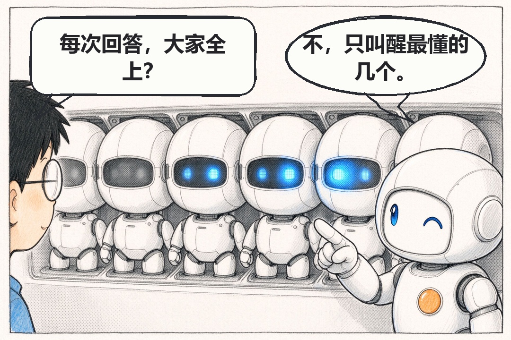
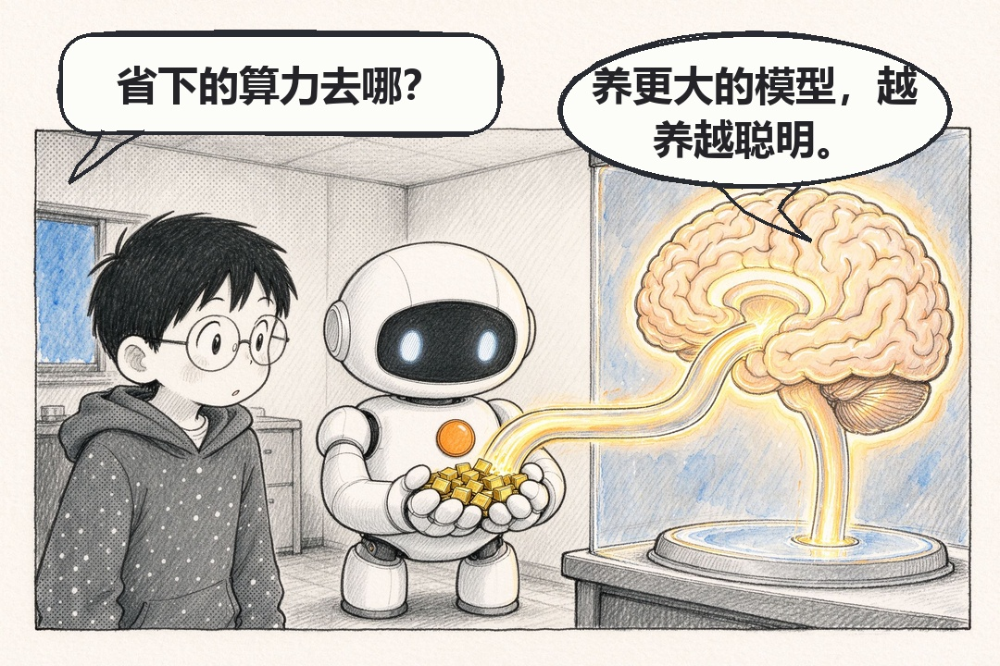
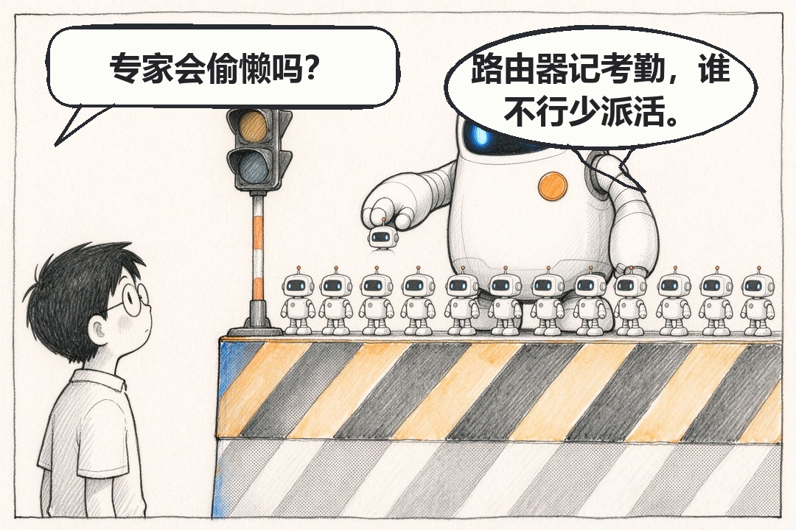
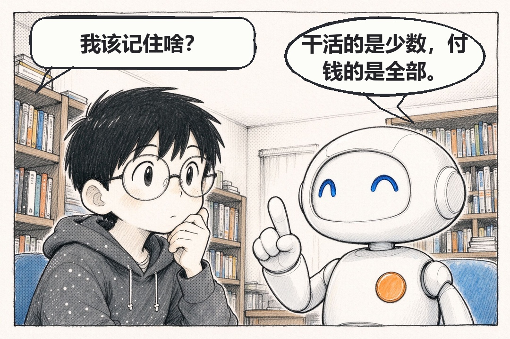
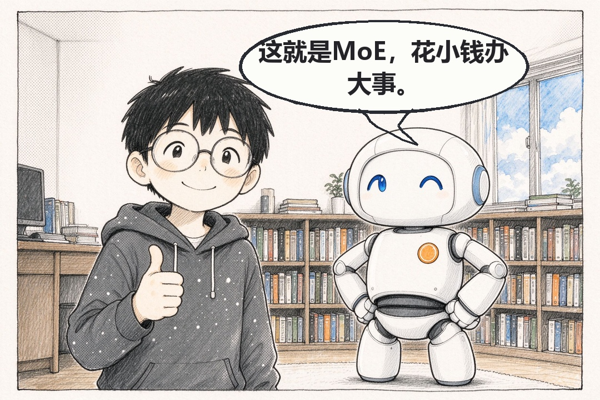

# 技术文章为什么不能是漫画？我用 Seed-2.1-pro-0915 做了个开源项目来回答

> 豆包 Seed 征文 · 方向一（Case 向）· 2026-09-23

今天下午这话的第一格刚渲出来，自动质检就在右下角圈了个红框：疑似文字区。

画面上一个字都没有——我特意要求过一个字都不许画。哪来的文字。

放大。是一块木纹。



OCR 把木头的纹理认成了字。虚惊一场。

这一周，这种事在 comic-maker 里天天发生。这个项目是拿 Seed-2.1-pro-0915 加豆包工作打磨出来的，前后一周，把技术概念画成一问一答的长漫画：模型负责画，代码负责写，质检负责挑错，我负责最后那个判断。



为什么偏偏是这三方分工，是被坑出来的，不是我一开始就设计好的。下面把今天跑的这一话《MoE：为什么大模型里住着一群专家》从头到尾拆一遍。

## 一、漫画真正的价值，是逼你把话说短

先回答标题那个问题：技术文章为什么要画成漫画。

不是为了好看。是因为漫画会逼你说人话。

文字稿里我最爱写这种句子："MoE 通过稀疏激活，在维持模型参数规模的同时显著降低了推理计算开销。"看着通顺，信息也够密，但它没回答任何一个真问题——省在哪？谁在干活？为什么不全上？读者看完点头，然后什么也没记住。

换成漫画，你只有一格画面、一个气泡、22 个字的额度。



于是只能挑最关键的那个点讲：每次回答，不是所有专家全上，只叫醒最懂的几个。



这一周做下来，我删掉的分镜比留下的多。多数不是画不出来，是我发现自己没法用一句话讲清楚——那说明我没真懂。



这条约束，才是漫画对技术写作真正的贡献。

## 二、最大的坑：让模型写字

想法很自然：既然 AI 画图，那气泡和台词当然也让它一起画。一开始我就是这么干的。

结果是个盲盒。今天乱码，明天气泡溢出格子，后天字正好盖在小码脸上。修一版换一种错法，登记在 `docs/ROOT-CAUSES.md` 里，从 R1 到 R19。

转折是我承认了一件事：让概率模型干需要精确排版的事，是在跟它的工作原理对着干。

生成每一步都在采样，你却指望它每次把字落在同一个位置、不多不少塞满一行。这不是能力不够，是方向错了。

所以我把文字层整个拿走，交给代码。台词、气泡、字号、换行、拼装全算出来——不再存在"生成得不好"，只有"算错了"，而算错能复现、能写测试、能彻底修好。现在绘泡统一在 44px 字号档，lint 一跑就知道整话有没有跑偏：

```
v8-01 ['OK']
v8-02 ['OK']
v8-03 ['OK']
v8-04 ['OK']
v8-05 ['OK']
v8-06 ['OK']
TIER-UNIFORM ['OK 44px ratio 1.00']
LINT: PASS
```

也正是在这里，Seed-2.1-pro-0915 让我愣了一下。我让它帮我把绘泡脚本改一版，把仓库脚本和一张分镜草图一起扔过去——它没追着我问一堆需求，自己把代码读了一遍、改了、跑测试给我看。

这次的差别很关键：它不用"猜"字该排在哪，它改的是代码。写代码本来就是它的强项，而且改完的不确定性有测试兜着。豆包这次把大型代码仓库的理解评测集推高了 12.4%，跨文件定位根因、修 bug 的能力涨了 33%[1]，分数我没先看，是我自己撞上的。

## 三、让它画得一样，比让它画得好更难

第二个坑是确定性。



同一个角色隔一格就可能换张脸、换件衣服。不是画得难看，是不像同一个人。

办法一点都不优雅：定妆照加锁参数，每话出图前先把角色的定妆照喂回去，把外观钉住。这些话跑下来，小码一直是黑短发、圆框眼镜、深灰连帽衫，波普一直是那颗橙胸徽，没漂过。

这不是模型变强了，是我在流程上把它会漂的地方提前堵死了。

## 四、画面是概率的，所以必须有东西盯着

画面归模型、文字归代码之后，还差一件事：谁来确认这一格画对了。

肉眼不行。一话十格检查二十分钟起步，人会疲劳、会放过。

所以质检也得自动化：每格出完图，让模型自己回头看——眼镜还在不在、有没有混进文字、有没有水印，结果输出成结构化 JSON 直接进 CI。开头那个红框就是这么来的。

但别忘了木纹这件事：质检本身也是模型，一样会犯错。它把木纹认成文字，我放大一眼排除了；反过来，哪天它漏掉一处真的水印，代价就大多了。

所以这套流程最后一条规矩是：模型负责标记，人负责确认，宁可多标，不可漏标。



到这儿才算完整——模型画画，代码保证精确，质检挑错，人做判断。缺任何一环，这条流水线都出不了成品。



6 格拼成 1080px 长图，就是开头那张。

## 五、Seed-2.1-pro-0915 到底补了哪儿

生图能力其实早就够了，真缺的是另外两头。

一头是敢不敢撒谎。工具调用幻觉专项得分从 38.4% 提到 64.8%，搜索幻觉改善接近一半[2]——它不会没查证就编给你，也不会假装把活干完了。这条直接决定我敢不敢把 CI 里的判定交给它。

另一头是成本。图像和视频推理的 Token 消耗降了 30% 以上[3]，逐格质检从"理论上可行"变成"每天都跑得起"。

三块拼齐，漫画才从 demo 变成一条能天天跑的流水线。

不过每话我仍然要人验收。它把"手盯每一步"变成"验收成品"，省掉的是重复劳动，不是判断。木纹那个红框就是提醒：越信它，越要有制度上的那双眼睛。

## 结尾

项目全量开源：https://github.com/aiyinluya/comic-maker 。出图、绘泡、质检、博客生成器都在，README 有完整用法，今天这话的复现包在 `stories/` 下。

如果 AI 已经能把技术文章画成漫画，那下一个问题也许是：它能不能自己把漫画发出去。这个我还没试。

---

能力数据来源：
[1] 新华网报道 http://imgs.xinhuanet.com/tech/20260916/6c5139a7840145b6b11f0ae9e00d9cb2/c.html ；搜狐科技 https://news.sohu.com/a/1077252529_122518389
[2] 搜狐科技（工具调用与搜索幻觉得分）https://news.sohu.com/a/1077252529_122518389
[3] 今日头条 http://m.toutiao.com/group/7685983554416755236/ ；火山引擎文档 https://www.volcengine.com/docs/82379/2549861?lang=zh
