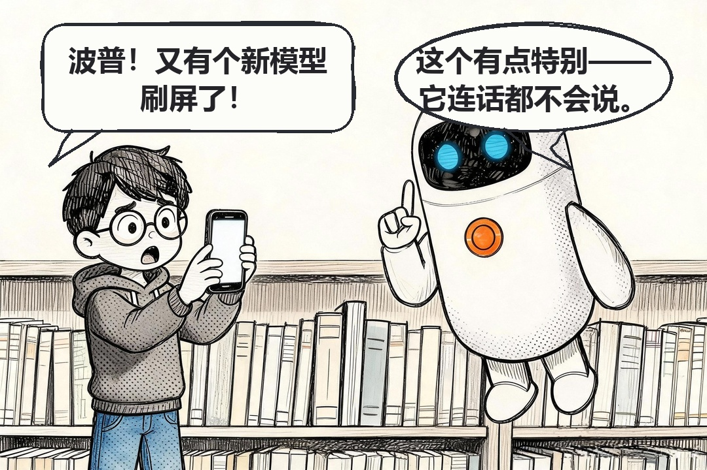
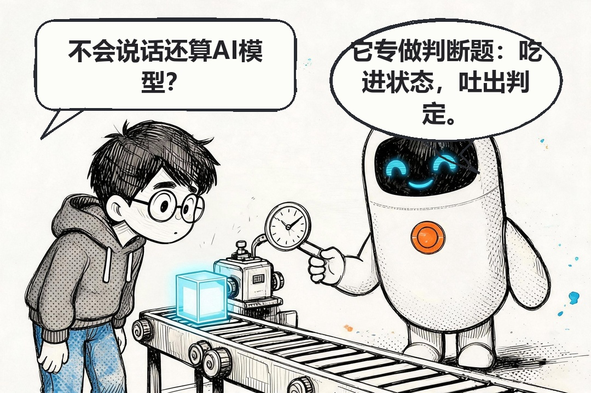
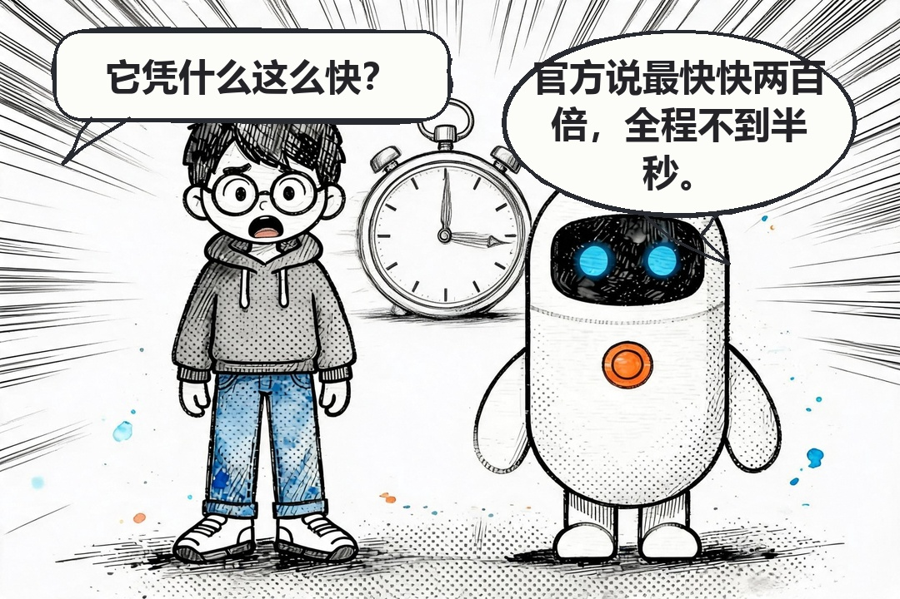
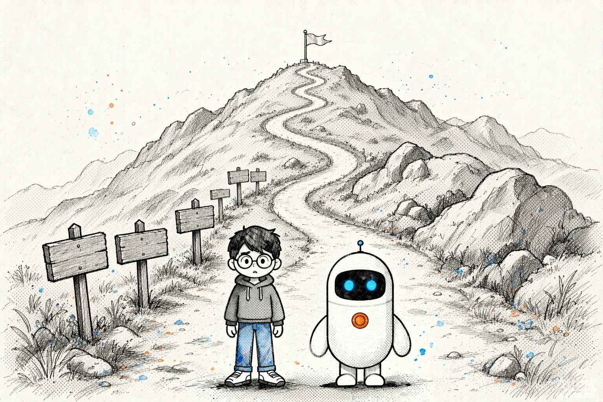
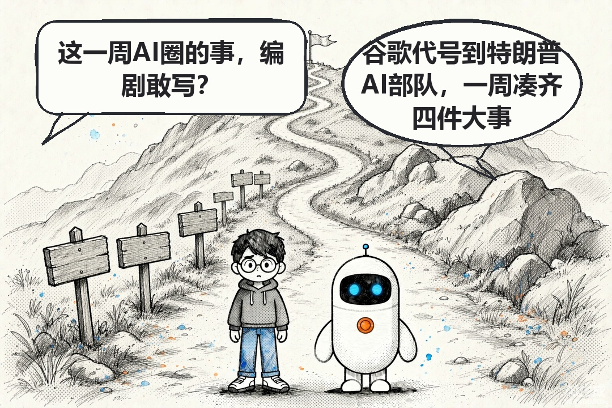
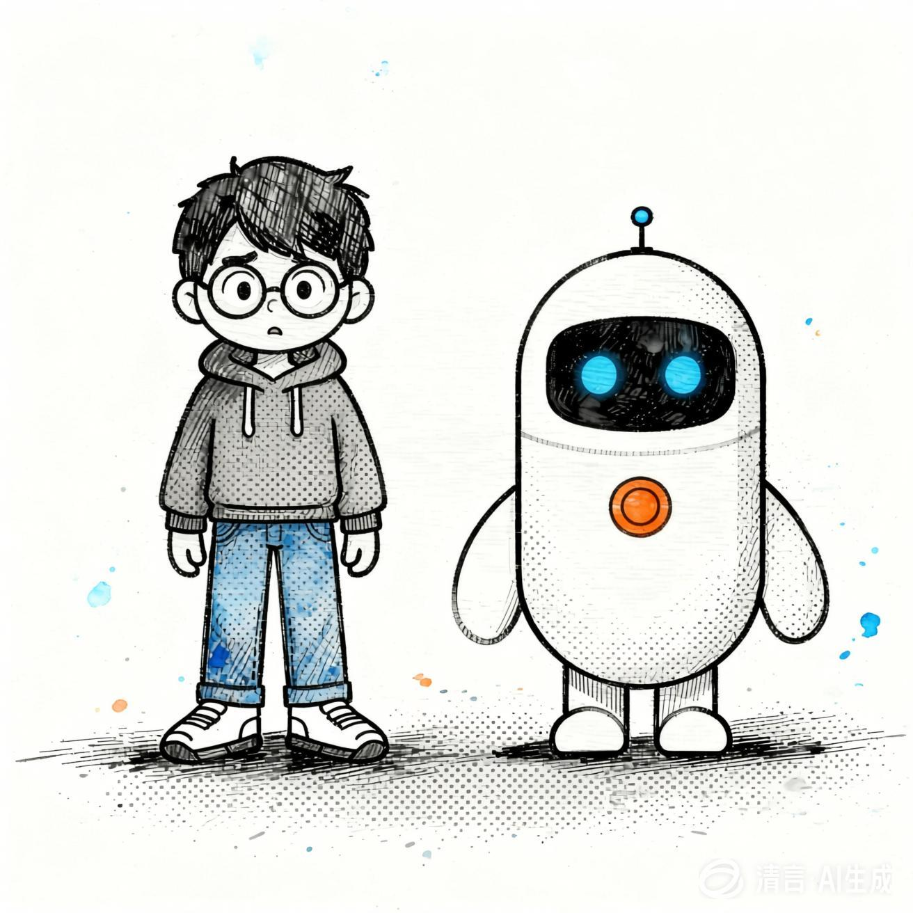
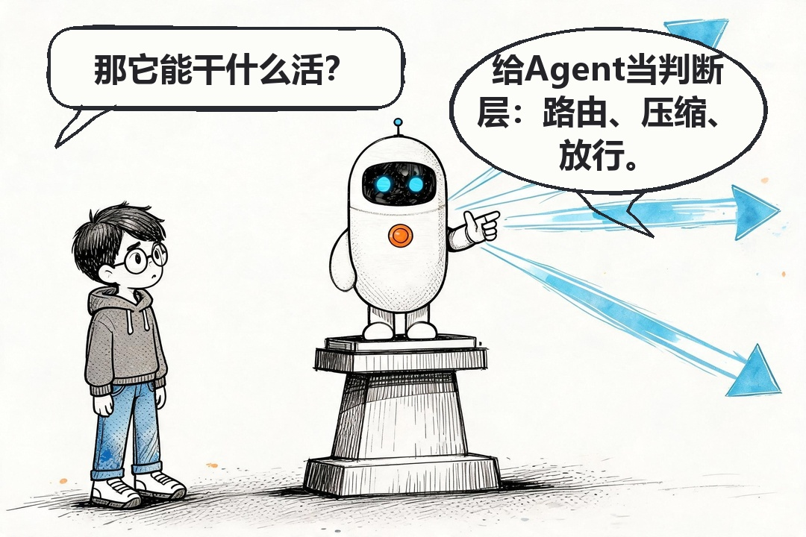
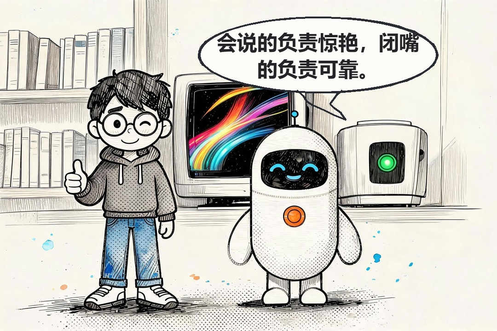
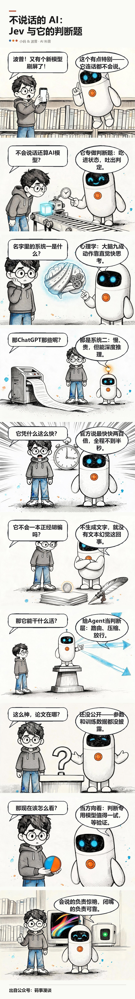

# 【征文】我用 WorkBuddy 做出了一个把技术文章画成漫画的项目

9 月 15 日，一家叫 TypeSafe AI 的公司发了个模型，名字叫 Jev。它不聊天，不写代码，也不写文章；你拿开放性问题问它，它一概不理。

可它火了。创办这家公司的是前 OpenAI 研究员 Diogo Almeida，他们还给 Jev 起了个新类别名：System One Model，译过来叫"系统一模型"。几天之内，讨论刷遍了开发者社区。

我想写它，卡在一个地方：**"系统一模型"这个概念，纯文字讲不利索。** 传统大模型的输出是一段一段文字；Jev 的输出里没有文字——你给它一份状态数据加一组预定义问题，它直接吐出结构化判定和一个概率。这点差别，写下来得两三段，读者读完点头，脑子里还是没画面。

所以我决定把它画成漫画。可麻烦的是手头没有趁手的工具：现成的 AI 生图一画中文就错字，气泡歪歪扭扭。于是我用 WorkBuddy 做了一个，叫 comic-maker。

我让它干的，是把整条链路从零搭起来——写脚本、出图、绘气泡、拼装、出图文，全在 WorkBuddy 里跑。现在它每期能稳定产出一篇文字加漫画的技术文章，Jev 这期就是它做的。

## 一、画漫画，逼我把话说到点子上

拿 Jev 举例。

一格画面就能说清：传送带把状态块送进去，判定牌吐出来。

再比如"快多少"。官方口径是端到端响应 70 到 500 毫秒，同等智能水平下比 LLM 快 40 到 200 倍。数字好记，可"快"是什么感觉，数字给不了——一格秒表，读者秒懂。

分镜有个硬规矩：每句台词 **≤ 22 字**，一问一答各一句。这条约束反过来逼我——讲不清的点，多数不是画不出来，是我自己没想明白。Jev 那期，我删掉的分镜比留下的多。

## 二、做这个项目，最难的一个判断：不让模型写字

一句话：**生成模型只画没有气泡、没有文字的空场景，气泡和台词全部由代码画。**

早期我让模型连气泡一起画，结果是个盲盒：中文错字、文字溢出格子、字号忽大忽小、气泡正好盖在角色脸上。修一版，换一种错法。根子在于模型画的气泡没有几何保证——你是在跟一个采样过程要排版精度。

文字改用 Pillow 渲染之后，这几类问题从根上消失了：不会乱码；气泡和文字在同一个坐标系里，不会溢出；字号是全局档位，只会一致。

*同一格的出图原图，画面上没有气泡也没有文字*

*代码绘气泡后的终版，上方气泡区是算出来的*

角色靠定妆照锁。小码（提问者，黑短发、圆框眼镜、深灰连帽衫）和波普（解答者，白色胶囊形小机器人）共用一张基准图，每次出图前喂回去。

*定妆照，每次出图前作为参考图传入*

这些规矩都是踩出来的，登记在 `docs/ROOT-CAUSES.md`，从 R1 到 R20。

## 三、它现在长什么样：WorkBuddy 里的八步

跑通之后，我把它做成一个可复用的 Skill，挂在 `~/.workbuddy/skills/comic-maker`。每期我只给一句话：拿这篇源文章，出一期漫画。它按八步跑完。

**1. 文案先行。** 有现成文章就用 `article_to_storyboard.py` 出分镜草稿，没有就先写 `draft.md`。不改完文案不许开画。

**2. 分镜锁定。** `storyboard.md` 五列：文件、提问、解答、画面。每句台词 **≤ 22 字**，一问一答各一句。分镜要先给我看，我说 OK 才出图。

**3. 定妆照。** 老角色直接复用基准图。出图提示词必须**内联完整身份标记**——发型、眼镜、服装、配色逐项写出来。只写"保持参考图造型"必丢眼镜（R1）。

**4. 转气泡配置。** `parse_storyboard.py` 产出 `bubbles.json`，这是全链路的单一事实源。

**5. 空场景出格。** 这条最容易踩。提示词里禁止出现"气泡""文字""字幕"；还必须带一句"远景小人物"的构图描述——只写"上方留出空白"没用，ImageGen 会以为你要的是背景留白，人物照样占满画面，头顶正好被气泡盖住。然后是串行：一次只出一张，落盘后立刻重命名成 `v8-NN.raw.jpg`，再出下一张。并行调用会共享输出目录、同名文件互相覆盖，最后一期只剩一张图。

**6. 出图后自检。** 跑一遍自检脚本，看有没有格的头会伸进气泡区；再逐格看图，确认角色要素齐不齐。不合格就重出这一格。

**7. 代码绘气泡。** `draw_bubbles.py` 把所有源图重采样到 1080px 成品宽度，再按 `SIZE_TIERS=[44,38,32,26]` 逐档试排，第一档能塞进 0.55H 就用。说话人只靠气泡形状区分——小码是圆角矩形带左下尾，波普是椭圆带锯齿尾；不靠字重。

**8. 拼装出图文。** `stack.py` 读 `stack.json`，加标题区、竖拼、加页脚，出 `long-manga.jpg`；`gen_blog.py` 再把分镜产成三版：Markdown 图文版、杂志风 HTML、公众号复制版。

八步里最要紧的一处，是出图统一走 **WorkBuddy 内置的 ImageGen**（图生图传 `image1`）。不用另配出图后端，这套流程才能每期稳定跑下来。

## 四、成品：Jev 那期

TypeSafe 给 Jev 点了三个用法：Agent 路由、上下文压缩、操作放行。这格画的是它想站在 Agent 的马路中间。

成品是张 1080 宽的竖版长图，公众号直接就能用：

`stories/` 下存着可直接复现的锁定分镜，`articles/` 下有多篇源文章，都能拿来跑。

## 五、还不行的地方

串行出图那条纪律别图快——我并行过一次，最后一期只剩一张图。

数据也得自己打折。Jev 那个"快 40 到 200 倍"是 TypeSafe 的官方口径，论文没公开，参数规模、网络结构、训练数据一概没披露，36 氪当时的标题直接问"Jev 真是新范式吗"。所以那期漫画里我写的是"当方向看，别当结论看"。漫画把概念讲清楚是强项，可一个没验证的数字画进画面，比写在段落里更容易被当成定论。

每期我仍然要验收。它把"每格都盯"变成"看几处"，省掉的是重复劳动，不是判断。

## 结尾

现在的状态是：一篇源文章进去，一张长图加三版图文出来，我只在分镜确认和终检两处插手。

代码全开源，仓库在这儿：https://github.com/aiyinluya/comic-maker

下一步想解决的是最后一公里：漫画现在能直接发文，那能不能直接做成视频？把一格一格推成镜头、配上节奏——这条链路还没做。
